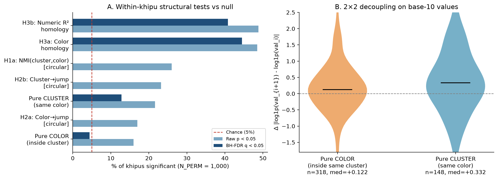
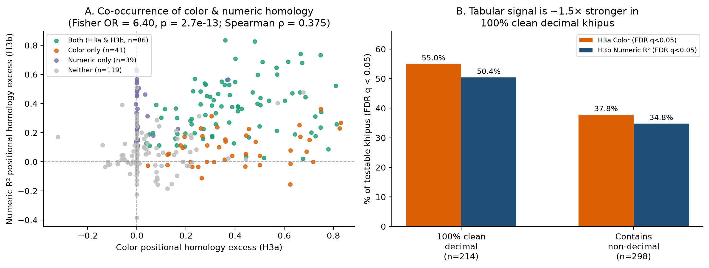

# khipu-intra-grammar

**Within-khipu structural grammar in the Open Khipu Repository (OKR v2.1.0): color, spatial grouping, base-10 tabular homology, and null-calibrated sum detection.**

Maria Contreras (Synapsa Strata Lab) · companion to [Khipu-ML](https://github.com/mcontrerasmalpar-pixel/Khipu-ML) ([arXiv:2607.00185](https://arxiv.org/abs/2607.00185)) · data [OKR v2.1.0](https://doi.org/10.5281/zenodo.18025748)

---

## Why intra-khipu?

In our audit of *inter-khipu* clustering and provenance classification ([Khipu-ML](https://github.com/mcontrerasmalpar-pixel/Khipu-ML), arXiv:2607.00185 v2), corpus-wide clusters collapsed once empty records, unrecorded twist, and cataloger/museum confounds were controlled. Here we invert the design: **every khipu serves as its own paired control** via within-khipu permutation and circular-shift nulls across **512 khipus** ($\ge 10$ pendant cords; 38,854 pendants; 79.1% clean base-10 decimal decoding on knotted cords).

## Key results (`N_PERM = 1,000`, BH-FDR $q < 0.05$)

| Test | `n` | Median excess | Wilcoxon $p$ | Raw $p < 0.05$ | **BH-FDR $q < 0.05$** |
|---|---:|---:|---:|---:|---:|
| **H3a** Color positional homology across equal-sized groups ($m \ge 3$) | 299 | `+0.113` | $4.89 \times 10^{-33}$ | 48.5% | **44.5% (133)** |
| **H3b** Numeric ($R^2$) positional homology across equal-sized groups | 326 | `+0.128` | $2.88 \times 10^{-35}$ | 48.8% | **40.8% (133)** |
| **Pure CLUSTER** boundary → $\|\Delta \log(\text{val})\|$ (same color) | 148 | `+0.332` | $2.10 \times 10^{-5}$ | 21.6% | **12.8% (19)** |
| **Pure COLOR** boundary → $\|\Delta \log(\text{val})\|$ (inside same cluster) | 318 | `+0.122` | $3.88 \times 10^{-4}$ | 16.0% | **4.4% (14)** |
| **H1a** `NMI(cord_cluster, color)` [circular shift] | 443 | `+0.016` | $1.75 \times 10^{-19}$ | 26.0% | *(corpus-level)* |
| **H2b** `cord_cluster` → $\|\Delta \log(\text{val})\|$ [circular shift] | 384 | `+0.419` | $1.60 \times 10^{-26}$ | 23.2% | *(corpus-level)* |

- **Color and numeric homology co-occur strongly** (`n = 285` testable for both, BH-FDR $q < 0.05$): **86** doubly-tabular khipus, Fisher exact **OR = 6.40** ($p = 2.66 \times 10^{-13}$), Spearman $\rho = 0.375$ ($p = 6.39 \times 10^{-11}$).
- **Stronger in 100% clean decimal khipus:** H3a FDR = **55.0%** and H3b FDR = **50.4%** (`n = 214`) vs 37.8% / 34.8% in khipus with non-decimal irregularities (`n = 298`).
- **Cataloger- and museum-invariant (H4):** holds independently across `UR`, `AS`, `HP`, and `JC` and across all 10 major holding museums ($n \ge 15$).
- **Null-calibrated sum detection (H5, `N_PERM = 500`):** within-cluster boundary subtotals (H5b) match chance (**36 observed vs 35.4 expected**, `1.02×`, Wilcoxon $p = 0.868$), while cross-group homologous-slot sums (H5c) show modest enrichment (**32 vs 17.8**, `1.80×`, concentrated in ~6 specimens such as `KH0134` and `KH0381`), indicating that most tabular khipus are parallel records rather than self-totaling sheets.




## Reproduce

```bash
git clone https://github.com/mcontrerasmalpar-pixel/khipu-intra-grammar.git
cd khipu-intra-grammar
python -m venv .venv && source .venv/bin/activate
pip install -r requirements.txt
export KHIPU_DB_PATH=/path/to/khipu.db   # OKR v2.1.0 from DOI 10.5281/zenodo.18025748

# Full pipeline
python src/pilot_h1_h2.py
python src/controls_h1_h2_h3.py
python src/deep_dive_fdr_h3.py
python src/extension_h5_sums.py
python src/make_figures.py
```

Or open [`notebooks/01_intra_khipu_grammar.ipynb`](notebooks/01_intra_khipu_grammar.ipynb) (loads precomputed tables in `results/` by default; set `RECOMPUTE = True` to re-run all permutations from `khipu.db`).

```
notebooks/   01_intra_khipu_grammar.ipynb
src/         pilot_h1_h2.py, controls_h1_h2_h3.py, deep_dive_fdr_h3.py,
             extension_h5_sums.py, make_figures.py
results/     versioned CSV tables (N_PERM = 1,000 / 500)
figures/     publication PNG figures (200 DPI)
```
